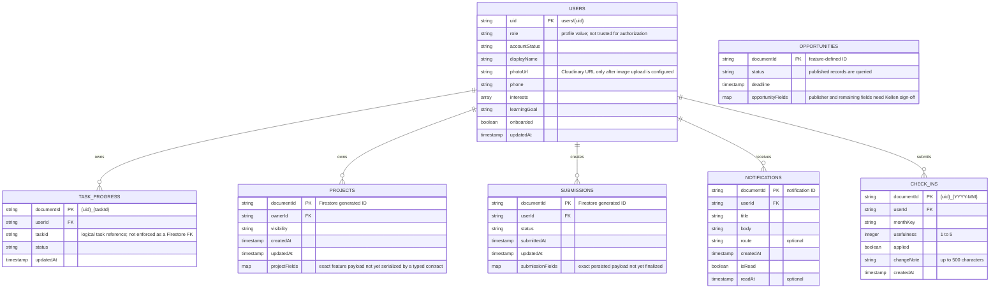

# Firestore ERD and implementation status

## Ownership and source of truth

Jonathan owns the project-level ERD and coordinates Firebase integration. Feature owners must confirm their document fields, identifiers, transitions, and access rules before those entities are approved. The prior diagram was not found in the current repository, so there is no approved canonical ERD to carry forward. This file is a code-backed draft of collections used by current Firestore repositories; it is not a claim that every app feature is persisted.

Firestore does not enforce relational foreign keys. `userId` and `ownerId` are ownership fields checked by rules. `taskId` is a logical identifier. Firestore document IDs are the primary identifiers; the check-in ID encodes its user and month to make the one-per-month rule enforceable.

## What is actually wired

| Collection | Code-backed operation | Status |
|---|---|---|
| `users` | Profile read/write methods; admin reads and counts | Profile allowlist exists. Auth screens do not call these methods yet. |
| `taskProgress` | Per-user status write/read and home count query | Shared repository method is not currently called by the task UI. |
| `projects` | Owner-scoped create/watch and home count query | Portfolio screens still use `AppStore`; the Firestore map has no typed serializer. |
| `submissions` | Submit/watch and home count query | Submission screens still use `AppStore`; the Firestore payload is not finalized. |
| `opportunities` | Published listing reads and home count query | Opportunity screens and admin write actions are not fully connected. Kellen owns the schema. |
| `notifications` | Recipient-scoped query and read-state update | Creation is server/feature-owned and currently has no client writer. |
| `checkIns` | One immutable response per user/month | This is the current home feature's explicit validated write contract. |

The collection constants and generic rules mention `learningPaths`, `learningTasks`, `reviews`, `mentorProfiles`, `mentorshipRequests`, `mentorSessions`, `applications`, `auditLogs`, and `appSettings`. A constant or rule does not mean a repository, seeded data, or complete document schema exists. Those collections are excluded from the implemented ERD until their owners confirm the contracts.

## Required teammate sign-off

- **Ghislaine:** `users` profile fields, registration fields, Google/email account linkage, role provisioning, and whether email/phone belong in Firestore.
- **Lisa:** learning path/task IDs and fields, progress transitions, review linkage, submission fields, portfolio fields, and choose one project path (`projects/{id}` or `users/{uid}/projects/{id}`).
- **Boaz:** mentor profile, mentorship request, session, review identities, and state transitions.
- **Kellen:** opportunity publication/moderation fields and application fields, IDs, ownership, and statuses.
- **Jonathan:** keep this ERD aligned with approved contracts, Firestore rules/indexes, and emulator tests.

After sign-off, replace the `map` placeholders with exact scalar/array fields and add the agreed relationships. Do not deploy rules or indexes based on this draft alone.
